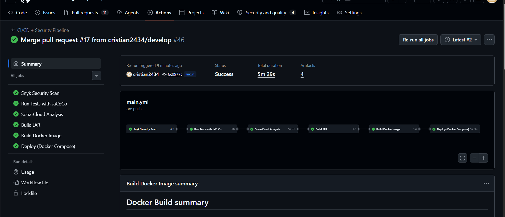
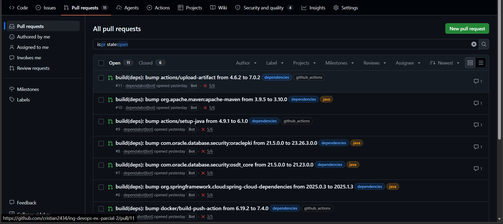
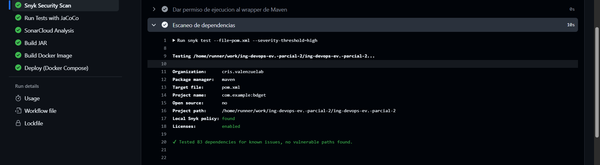
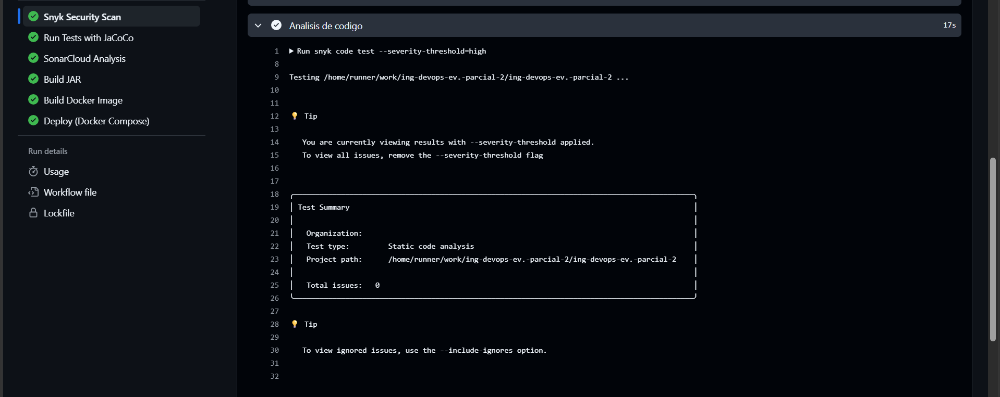
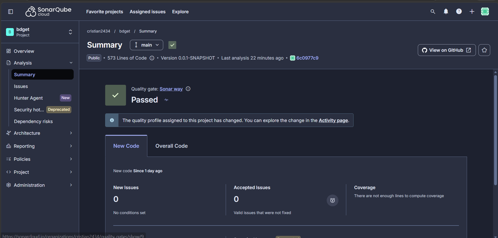
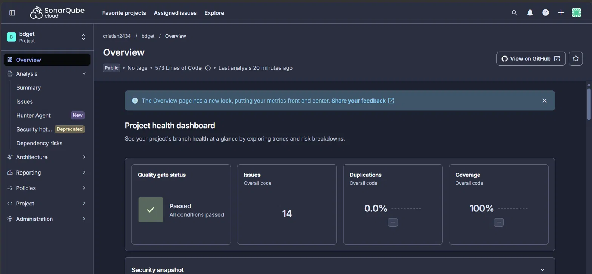
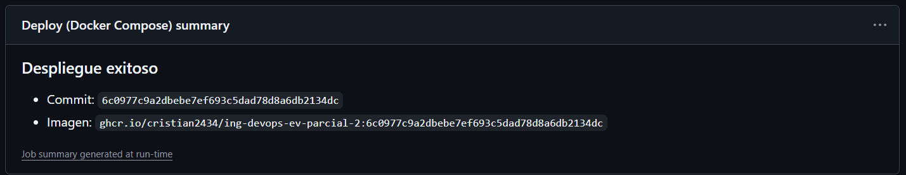
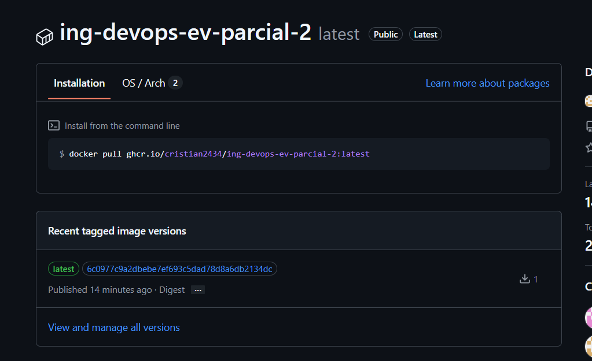

# bdget - Microservicio Base DevOps

> **Nota de entrega:** esta evaluación se realizó de forma **individual**, con autorización del docente.

## Propósito

**bdget** es un microservicio desarrollado en **Spring Boot 3 (Java 17)** que expone una API REST para la gestión de estudiantes (`Student`), conectado a una base de datos Oracle. Este repositorio es la base del pipeline DevOps de la asignatura Ingeniería DevOps (DOY0101): control de versiones con Git/GitHub y automatización de integración, seguridad, contenedores y despliegue con GitHub Actions.

## Instrucciones de configuración e instalación

### Requisitos previos
- Java 17 (JDK)
- Maven (o usar el wrapper incluido `mvnw` / `mvnw.cmd`)
- Una instancia de base de datos Oracle y su wallet (o Docker, ver más abajo)

### Clonar el repositorio
```bash
git clone https://github.com/cristian2434/ing-devops-ev.-parcial-2.git
cd ing-devops-ev.-parcial-2
```

### Configurar la base de datos
Edita `src/main/resources/application.properties` y reemplaza los valores de conexión:
```properties
spring.datasource.url=<db_url>
spring.datasource.username=<db_username>
spring.datasource.password=<db_password>
```
Los valores reales nunca se suben al repositorio. En el contenedor llegan por variables de entorno (`SPRING_DATASOURCE_*`).

### Ejecutar el proyecto localmente
```bash
./mvnw spring-boot:run
```
La aplicación queda disponible en `http://localhost:8081`.

### Ejecutar con Docker Compose
Requiere un archivo `.env` (no versionado) con las credenciales y la carpeta `wallet/` de Oracle en la raíz del proyecto (no versionada):
```bash
# .env
DB_TNS_ALIAS=<alias_tns>
DB_USERNAME=<usuario>
DB_PASSWORD=<contraseña>
```
```bash
docker compose up --build
```
El servicio queda en `http://localhost:8081` y se verifica con `curl http://localhost:8081/api/health`.

### Ejecutar los tests
```bash
./mvnw test
```

## Ejemplos de uso

| Método | Endpoint | Descripción |
|---|---|---|
| `GET` | `/students` | Lista todos los estudiantes |
| `GET` | `/students/{id}` | Obtiene un estudiante por ID |
| `GET` | `/students/search?name=juan` | Busca estudiantes por nombre (parcial, sin distinguir mayúsculas) |
| `POST` | `/students` | Crea un nuevo estudiante |
| `PUT` | `/students/{id}` | Actualiza un estudiante existente |
| `DELETE` | `/students/{id}` | Elimina un estudiante |
| `GET` | `/api/health` | Verifica el estado del servicio |

Ejemplo con `curl`:
```bash
curl http://localhost:8081/students/search?name=maria
```

---

## Estrategia de Ramificación: GitFlow

### ¿Qué son GitFlow y Trunk-Based Development?

**GitFlow** es una estrategia de ramificación estructurada que organiza el desarrollo en ramas específicas:
- **main** (producción)
- **develop** (desarrollo)
- **feature** (nuevas funcionalidades)
- **release** (preparación de versiones)
- **hotfix** (correcciones urgentes)

**Trunk-Based Development (TBD)** es un enfoque más ágil donde todos los desarrolladores integran sus cambios frecuentemente en una única rama principal (`main` o `trunk`), usando ramas de corta duración que se fusionan rápidamente.

### Justificación de la elección

Elegí **GitFlow** para este proyecto porque:
- Separa claramente el código en producción (`main`) del código en desarrollo activo (`develop`), lo cual da estabilidad mientras se integran nuevas funcionalidades.
- Permite trabajar features de forma aislada (`feature/<nombre>`) sin afectar la rama estable, manteniendo trazabilidad clara de qué cambio corresponde a qué propósito.
- Facilita correcciones urgentes mediante ramas `hotfix/<nombre>`, que se crean desde `main` y se integran tanto a `main` como a `develop`, sin interrumpir el desarrollo en curso.
- En un entorno colaborativo en la nube (GitHub), GitFlow da control explícito sobre qué llega a producción mediante Pull Requests revisados, lo cual es apropiado para un proyecto académico donde se evalúa el proceso, no solo el resultado final.
- A diferencia de Trunk-Based Development —que exige integración continua muy frecuente y una suite de pruebas automatizadas robusta para minimizar riesgos de romper `main`—, GitFlow se adapta mejor a un ritmo de trabajo con avances puntuales, no despliegues varias veces al día.

### Estructura de Ramas del repositorio
- `main`: código estable, listo para producción. Un push a esta rama dispara el despliegue.
- `develop`: rama de integración, donde se juntan los cambios antes de pasar a `main`.
- `feature/<nombre>`: nuevas funcionalidades, creadas desde `develop` y mergeadas de vuelta a `develop`.
- `hotfix/<nombre>`: correcciones urgentes, creadas desde `main` y mergeadas tanto a `main` como a `develop`.

---

## Convenciones de Commits

Formato: `tipo: descripción breve en presente`

| Tipo | Uso |
|---|---|
| `feat:` | nueva funcionalidad |
| `fix:` | corrección de un bug |
| `docs:` | cambios de documentación |
| `chore:` | tareas de mantenimiento (configuración, dependencias, etc.) |
| `test:` | agregar o modificar tests |
| `ci:` | cambios en la configuración de integración continua |
| `sec:` | cambios de seguridad (por ejemplo, política de Snyk) |

Ejemplos reales usados en este repositorio:
- `feat: agregar busqueda de estudiantes por nombre`
- `feat: agregar endpoint de health check`
- `fix: capturar ruta real de la peticion y eliminar imports duplicados`
- `ci: usar nombre de imagen valido para GHCR`
- `sec: registrar riesgos aceptados de Snyk con vencimiento`

## Naming de Ramas

- `feature/nombre-corto-descriptivo` (ej. `feature/busqueda-por-nombre`, `feature/health-check`)
- `hotfix/nombre-corto-descriptivo` (ej. `hotfix/ruta-real-en-errores`)

## Estructura de Carpetas

```
.github/
├── dependabot.yml        # Actualización automática de dependencias
└── workflows/main.yml    # Pipeline CI/CD
docs/img/                 # Capturas de evidencia del pipeline
src/main/java/com/example/bdget/
├── controller/           # Endpoints REST (StudentController, HealthController)
├── service/              # Lógica de negocio (interfaz + implementación)
├── repository/           # Acceso a datos (Spring Data JPA)
├── model/                # Entidades (Student)
└── exception/            # Manejo global de excepciones
src/test/java/com/example/bdget/
└── ...                   # Tests unitarios por capa (controller, service, model, exception)
Dockerfile                # Imagen multi-etapa
docker-compose.yml        # Orquestación y despliegue
.snyk                     # Política de Snyk (riesgos aceptados con vencimiento)
```

## Control de Versiones y Flujo de Merge

1. Los cambios se desarrollan en `develop` (o en ramas `feature/` y `hotfix/`) y llegan a `main` **solo mediante Pull Request**.
2. Se verifica que el pipeline de GitHub Actions pase correctamente antes de mergear cada PR.
3. Los `hotfix`, una vez mergeados a `main`, también se mergean a `develop` para mantener sincronizadas ambas ramas.
4. Las ramas ya mergeadas se eliminan para mantener el repositorio limpio.

## Estrategia de Revisión

- Ningún cambio llega a `main` sin pasar por un Pull Request, aunque se trate de un único desarrollador, para dejar registro formal y trazable de cada cambio.
- El PR describe brevemente qué cambia y por qué.
- Se revisa que el pipeline de CI (seguridad, tests, calidad y build) pase en verde antes de aprobar el merge.
- Se prioriza revisar: consistencia de nombres, que el cambio no rompa funcionalidad existente, y que incluya sus pruebas correspondientes si aplica.

---

## Pipeline CI/CD — GitHub Actions

El pipeline está definido en `.github/workflows/main.yml`. Se ejecuta en cada **push a `main` y `develop`** y en cada **Pull Request hacia `main`**. Si llega un nuevo push a la misma rama, se cancela la ejecución anterior (`concurrency`).

Los seis jobs están **encadenados con `needs`**: cada uno solo corre si el anterior terminó bien. Si uno falla, los siguientes se omiten.

```
Snyk Security Scan → Run Tests with JaCoCo → SonarCloud Analysis → Build JAR → Build Docker Image → Deploy (Docker Compose)
```

| Job | Qué hace | Indicador |
|---|---|---|
| `snyk-scan` | `snyk test` (dependencias) y `snyk code test` (código). Falla con vulnerabilidades de severidad **alta o crítica**. Guarda el reporte JSON como artefacto. | IE3 |
| `test` | `mvn clean verify`: 19 pruebas unitarias (JUnit) y verificación de cobertura con JaCoCo. Sube el reporte como artefacto. | IE2 |
| `sonar` | Análisis de calidad con SonarCloud y espera el Quality Gate (`sonar.qualitygate.wait=true`). | IE3 |
| `build` | Empaqueta el JAR (`mvn clean package -DskipTests`) y lo sube como artefacto. | IE1 |
| `docker` | Construye la imagen con el `Dockerfile` multi-etapa. En `main` la publica en GHCR. | IE1, IE4 |
| `deploy` | Solo en push a `main`. Levanta el servicio con Docker Compose en el runner, espera el estado `healthy`, ejecuta una prueba de humo a `/api/health` y publica un resumen. | IE4, IE5 |

En un Pull Request el pipeline llega hasta `docker` (construye la imagen sin publicarla); el despliegue ocurre únicamente tras el merge a `main`.



### Contenedores (IE1)
- `Dockerfile` multi-etapa: dependencias (caché de Maven), compilación con JDK 17 y ejecución con imagen **JRE 17**, más liviana.
- Se ejecuta con un usuario no root (`appuser`).
- `.dockerignore` excluye `target/`, credenciales, wallet y documentación, para que no entren a la imagen.
- Los secretos nunca están en la imagen: se inyectan por variables de entorno y el wallet se monta como volumen de solo lectura.

### Orquestación (IE5)
`docker-compose.yml` define el servicio con:
- Puerto `8081:8081`.
- `healthcheck` sobre `/api/health` (cada 5 s, 5 reintentos, 60 s de gracia al arrancar).
- Límites y reservas de recursos: límite de **1 CPU y 1 GB**, reserva de 0,5 CPU y 512 MB.
- `restart: unless-stopped`.
- Endurecimiento: `no-new-privileges` y `cap_drop: ALL`.
- Wallet de Oracle montado como volumen de solo lectura.
- La imagen se parametriza con `APP_IMAGE`, de modo que el despliegue usa exactamente la imagen construida en el mismo run.

### Seguridad y bloqueos (IE3)
- **Dependabot** (`.github/dependabot.yml`) revisa semanalmente Maven, GitHub Actions y Docker y abre Pull Requests con las actualizaciones. Las actualizaciones que implican saltos mayores (por ejemplo, Spring Boot 4) no se aplican automáticamente: se evalúan antes de hacer merge.
- **Snyk** bloquea el pipeline si encuentra vulnerabilidades altas o críticas. Como los jobs están encadenados, si falla no se ejecutan las pruebas, ni la imagen, ni el despliegue.
- **SonarCloud** analiza la calidad del código y el pipeline espera su Quality Gate (`Sonar way`).
- En `Settings → Rules`, `main` queda protegida exigiendo que pasen los checks `Snyk Security Scan`, `Run Tests with JaCoCo` y `SonarCloud Analysis` antes de hacer merge.





#### Hallazgos corregidos sin migrar de versión
El 30-10-2026 Snyk detectó 5 hallazgos nuevos de severidad alta o crítica (4 en `tomcat-embed-core` 10.1.55 y 1 en `jackson-databind` 2.21.4) y bloqueó el pipeline. Como existía corrección dentro de la misma versión mayor, se resolvieron fijando `tomcat.version=10.1.61` y `jackson-bom.version=2.21.8` en el `pom.xml`, sin migrar a Spring Boot 4 ni agregar excepciones al `.snyk`.

#### Riesgo aceptado temporalmente (`.snyk`)
Tras actualizar a Spring Boot 3.5.15, Spring Cloud 2025.0.3 y JaCoCo 0.8.14, el escaneo bajó de 82 a **43 hallazgos** de severidad alta o crítica (Tomcat, Spring Framework, Logback, BouncyCastle y otras librerías internas de Spring). En todos, la corrección solo existe en **Spring Boot 4.0.0** (o Spring Cloud Config 5.0.5, que también exige Boot 4).

Migrar a Spring Boot 4 es un cambio mayor (otra versión de Hibernate y Jackson, cambios en las pruebas), que queda **fuera del alcance de esta evaluación**. Por eso estos 43 hallazgos están registrados en el archivo `.snyk`, cada uno con su motivo y una **fecha de vencimiento (31 de enero de 2027)**. No se trata de vulnerabilidades inexistentes, sino de **riesgo aceptado de forma temporal y documentada**, con el plan de migrar a Spring Boot 4. Cualquier hallazgo alto o crítico **nuevo** que no esté en esa lista sigue bloqueando el pipeline.

### Calidad (IE2)
- La política de calidad exige **al menos 70 % de cobertura de líneas** (JaCoCo, regla `check` en el `pom.xml`). Si baja de ese valor, `mvn verify` falla y el pipeline se detiene.
- Las 19 pruebas unitarias cubren las capas controller, service, model y el manejador global de excepciones, además del endpoint de salud.
- SonarCloud midió en este análisis **100 % de cobertura**, **0 % de duplicación** y el Quality Gate en estado **Passed**. El 70 % es el umbral que bloquea el pipeline; el 100 % es lo medido.




### Trazabilidad (IE4)
- Cada imagen se publica en GHCR etiquetada con el **SHA del commit** y con `latest`, y lleva labels OCI (`revision`, `source`).
- El nombre de la imagen es fijo: `ghcr.io/cristian2434/ing-devops-ev-parcial-2`. No se usa el nombre del repositorio porque este contiene `.-`, una combinación que Docker no acepta en una referencia de imagen.
- El job `deploy` despliega exactamente la imagen construida en ese mismo run, y el resumen del despliegue registra el commit y la imagen. En la captura, el SHA del commit coincide con la etiqueta de la imagen.
- Todo cambio llega a `main` por Pull Request, por lo que cada despliegue se puede rastrear: commit → PR → ejecución del pipeline → imagen → despliegue.




### Secretos requeridos en GitHub
En `Settings → Secrets and variables → Actions`:

| Secreto | Uso |
|---|---|
| `SNYK_TOKEN` | Autenticación de Snyk |
| `SONAR_TOKEN` | Autenticación de SonarCloud |
| `DB_TNS_ALIAS` | Alias TNS de la base Oracle (por ejemplo, `pruebadb_high`) |
| `DB_USERNAME` | Usuario de la base de datos |
| `DB_PASSWORD` | Contraseña de la base de datos |
| `DB_WALLET_ZIP_B64` | Wallet de Oracle en ZIP codificado en base64 |

El wallet que se usa en el despliegue contiene solo `cwallet.sso`, `tnsnames.ora` y `sqlnet.ora`, con `sqlnet.ora` apuntando a `/app/wallet`, que es donde Compose lo monta. Ningún secreto ni el wallet están en el repositorio.

---

## Funcionalidades agregadas en este trabajo

- **Búsqueda de estudiantes por nombre**: endpoint `GET /students/search?name=` (búsqueda parcial, insensible a mayúsculas/minúsculas), implementado en las capas Repository, Service y Controller, con su test unitario correspondiente.
- **Health Check**: endpoint `GET /api/health` que retorna el estado del servicio, usado por el healthcheck de Docker Compose y por la prueba de humo del despliegue.
- **Hotfix**: corrección en `GlobalExceptionHandler` para capturar la ruta real donde ocurre un error no controlado (antes no se informaba el endpoint afectado), además de limpieza de imports duplicados.

## Declaración de Uso de Inteligencia Artificial

Se utilizó IA (Claude, de Anthropic) como apoyo técnico para:
- Generar la plantilla del workflow de GitHub Actions, el `Dockerfile`, el `docker-compose.yml`, el `dependabot.yml` y las pruebas unitarias adicionales.
- Orientar la configuración de Snyk, SonarCloud, los secretos de GitHub y el wallet de Oracle.
- Ayudar a diagnosticar errores del pipeline (por ejemplo, el nombre de imagen inválido y el wallet incompleto).
- Redactar un borrador de las secciones técnicas de este README.
- Revisar y optimizar los tiempos del pipeline (un solo escaneo de Snyk, timeout del Quality Gate y healthcheck más rápido) y revisar este README.


Todo el contenido generado fue revisado, probado y validado por mí antes de integrarlo al repositorio: el pipeline se ejecutó completo en `main` y el despliegue quedó verificado. Las conclusiones y la reflexión personal fueron redactadas por mí; se usó IA únicamente para corregir ortografía y puntuación. Más información sobre uso ético de IA: https://bibliotecas.duoc.cl/ia

## Conclusiones y Reflexión Personal

### Evaluación 2

Cristian Valenzuela: Aprendí que el pipeline crea una imagen o varias imágenes a través de Docker. También entendí que existen varias herramientas para las pruebas unitarias, y no sabía que existía JaCoCo, porque antes había trabajado solo con JUnit, que ejecuta las pruebas, y con Mockito, que crea objetos simulados para aislar lo que se prueba. Tampoco sabía que Dependabot sirve para escanear las dependencias del proyecto, ni que para analizar el código se usa SonarQube o Snyk, o ambos a la vez. Además, aprendí a hacer el despliegue automático a través de Docker Compose y a reforzar cómo crear el GitHub Actions en la rama main, agregando más ramas si uno quiere.

En el Docker Compose puedo implementar una orquestación de contenedores, según el caso, para asegurar la estabilidad y la calidad.

Decidí aceptar los riesgos con fecha de vencimiento en lugar de migrar a Spring Boot 4.

Yo aporté en la implementación del pipeline de GitHub Actions con la construcción de la imagen con Docker, la ejecución de pruebas unitarias con JUnit (JaCoCo mide cuánto código cubren esas pruebas), la implementación de la orquestación de contenedores, el aseguramiento de la estabilidad y la calidad del sistema, la configuración de alertas o bloqueos si el análisis de seguridad falla y la configuración del Dockerfile de mi microservicio.

### Evaluación 1 (referencia)

Cristian Valenzuela: aprendi que existe diferentes tipos de ramas que antes no conocia. Ahora se que la rama feature se usa solo para agregar una nueva funcionalidad al proyecto; nunca habia trabajado con las ramas feature y hotfix antes. Antes solo usaba el main y a lo más creaba una rama extra para trabajar en un proyecto. 

Yo antes habia trabajado el hacer pull request para hacer la conexion con la rama main y tuve que aprender hacer cambios significativos para ver como funciona. 

Entendi la diferencia entre feature y hotfix que uno es para nueva funcionalidad y el otro para corregir errores urgentes. Tambien fue dificil al inicio trabajar solo pero después me acostumbre.